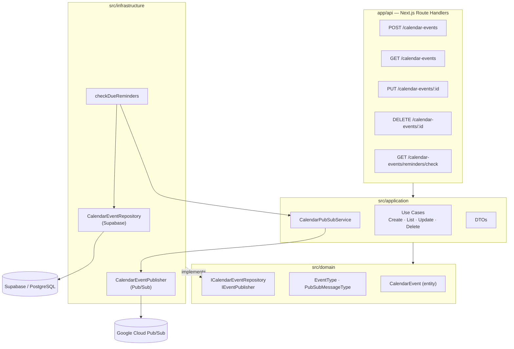
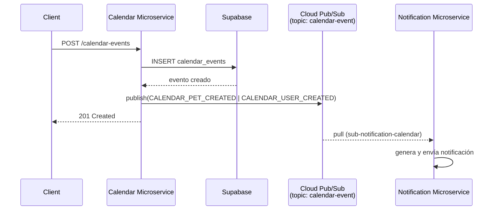

# 📅 Calendar Event Microservice

Microservicio de calendario para una plataforma de gestión de mascotas. Administra eventos de calendario tanto a nivel de **usuario** (recordatorios generales) como de **mascota** (citas veterinarias, vacunas, tratamientos), y publica cada cambio como un evento de dominio en **Google Cloud Pub/Sub** para que otros servicios (como el de notificaciones) reaccionen en tiempo real.

Construido con **Next.js (App Router)** como framework de API, **Supabase (PostgreSQL)** como persistencia, y una arquitectura por capas inspirada en **Clean Architecture**.

---

## Tabla de contenido

- [Arquitectura](#arquitectura)
- [Modelo de dominio](#modelo-de-dominio)
- [API Reference](#api-reference)
- [Arquitectura orientada a eventos (Pub/Sub)](#arquitectura-orientada-a-eventos-pubsub)
- [Recordatorios automáticos](#recordatorios-automáticos)
- [Empezando](#empezando)
- [Variables de entorno](#variables-de-entorno)
- [Testing](#testing)
- [Docker](#docker)
- [Despliegue en Google Cloud Run](#despliegue-en-google-cloud-run)
- [Estructura del proyecto](#estructura-del-proyecto)

---

## Arquitectura

El servicio sigue una separación por capas (dominio → aplicación → infraestructura), donde las dependencias solo apuntan hacia adentro:



> **Nota técnica:** los route handlers actuales (`app/api/**`) hablan directo con Supabase para las operaciones CRUD (por simplicidad y performance), mientras que el flujo de recordatorios (`checkDueReminders`) sí atraviesa toda la cadena limpia repositorio → servicio → publisher. Las capas de dominio/aplicación (entidades, casos de uso, interfaces) están completas y cubiertas por tests, listas para que las rutas las adopten por completo.

---

## Modelo de dominio

### `CalendarEvent`

| Campo             | Tipo                | Descripción                                                                 |
|-------------------|---------------------|------------------------------------------------------------------------------|
| `id`              | `string` (UUID)     | Identificador único del evento                                              |
| `userId`          | `string` (UUID)     | Dueño del evento                                                             |
| `petId`           | `string \| null`    | Mascota asociada. **`null` = evento de calendario de usuario**              |
| `title`           | `string`            | Título (máx. 255 caracteres)                                                |
| `description`     | `string \| null`    | Descripción opcional                                                        |
| `eventType`       | `EventType`         | Categoría del evento                                                        |
| `eventDate`       | `Date`              | Fecha del evento (debe ser futura al crearlo)                              |
| `reminderAt`      | `Date \| null`      | Fecha/hora exacta elegida por el usuario para el recordatorio              |
| `reminderEnabled` | `boolean`           | Si el recordatorio está activo                                              |
| `createdAt`       | `Date`              | Timestamp de creación                                                       |
| `updatedAt`       | `Date`              | Timestamp de última actualización                                          |

### `EventType`

```
VET_APPOINTMENT · MEDICATION · TREATMENT · GROOMING · OTHER
```

### Dos calendarios, una sola tabla

El mismo modelo sirve para dos vistas de calendario, distinguidas por la presencia de `petId`:

| Calendario | Condición        | Ejemplo                                  |
|------------|-------------------|-------------------------------------------|
| **Usuario** (Calendario A) | `petId = null`  | Recordatorio general no ligado a una mascota |
| **Mascota** (Calendario B) | `petId` presente | Cita veterinaria de una mascota específica  |

---

## API Reference

Base URL local: `http://localhost:3000/api`

### `POST /calendar-events`

Crea un evento. Si se omite `petId`, el evento pertenece al calendario de usuario.

<details>
<summary>Body</summary>

```json
{
  "userId": "uuid",
  "petId": "uuid | null (opcional)",
  "title": "string",
  "description": "string (opcional)",
  "eventType": "VET_APPOINTMENT | MEDICATION | TREATMENT | GROOMING | OTHER",
  "eventDate": "2026-07-15T10:00:00.000Z",
  "reminderAt": "2026-07-14T10:00:00.000Z (opcional)",
  "reminderEnabled": true
}
```
</details>

`201 Created` → el registro insertado. Publica `CALENDAR_PET_CREATED` o `CALENDAR_USER_CREATED` en Pub/Sub.

### `GET /calendar-events`

| Query param    | Requerido            | Efecto                                                        |
|----------------|----------------------|-----------------------------------------------------------------|
| `userId`       | Sí, salvo que envíes `petId` | Filtra por dueño                                        |
| `petId`        | No                   | Filtra por mascota específica (calendario de esa mascota)      |
| `calendarType` | No                   | `user` → solo eventos sin mascota · `pet` → solo eventos con mascota |

### `PUT /calendar-events/:id`

Actualiza cualquier campo (excepto `userId`/`id`). Requiere `userId` en el body para validar propiedad. Si se cambia `reminderAt` o `reminderEnabled`, resetea el estado de notificación para que el recordatorio pueda dispararse de nuevo. Publica `CALENDAR_EVENT_UPDATED`.

### `DELETE /calendar-events/:id?userId=`

Elimina el evento, validando propiedad vía `userId`.

### `GET /calendar-events/reminders/check`

Endpoint interno: busca recordatorios vencidos y no notificados, los publica en Pub/Sub y marca su estado. Pensado para ser invocado por un scheduler (ver [Recordatorios automáticos](#recordatorios-automáticos)).

---

## Arquitectura orientada a eventos (Pub/Sub)

Este servicio es **publisher únicamente** — no consume su propio topic. Forma parte de una malla de microservicios donde cada dominio (usuario, mascota, médico, calendario) publica a su propio topic, y un `notification-microservice` centralizado se suscribe a todos ellos.



### Contrato del mensaje (`DomainEvent`)

```json
{
  "eventType": "CALENDAR_PET_CREATED",
  "userId": "uuid",
  "payload": {
    "eventId": "uuid",
    "petId": "uuid | undefined",
    "userId": "uuid",
    "title": "string",
    "description": "string | undefined",
    "eventType": "VET_APPOINTMENT",
    "eventDate": "ISO date",
    "reminderAt": "ISO date | undefined",
    "reminderEnabled": true
  },
  "occurredAt": "ISO date"
}
```

| `eventType` (nivel raíz) | Cuándo se publica |
|---|---|
| `CALENDAR_PET_CREATED`   | Se crea un evento con `petId` |
| `CALENDAR_USER_CREATED`  | Se crea un evento sin `petId` |
| `CALENDAR_EVENT_UPDATED` | Se actualiza cualquier evento |
| `CALENDAR_EVENT_REMINDER`| El recordatorio de un evento vence |

---

## Recordatorios automáticos

Cada evento tiene su propio `reminderAt`, elegido libremente por el usuario. Un proceso periódico revisa qué recordatorios ya vencieron y los publica a Pub/Sub, con un límite de **3 intentos** antes de darse por vencido con ese recordatorio.

Cómo se dispara ese chequeo depende del entorno de despliegue (ver tabla), controlado por `ENABLE_INTERNAL_REMINDER_CRON`:

| Entorno | Mecanismo | Por qué |
|---|---|---|
| Docker / `docker-compose` | Cron en proceso (`node-cron`, cada minuto) | Contenedor persistente — el cron interno es confiable |
| `next dev` (local) | Cron en proceso | Mismo motivo, proceso de larga duración |
| Google Cloud Run | **Cloud Scheduler** → `GET /calendar-events/reminders/check` | Cloud Run puede escalar a cero entre requests; un cron en proceso no dispararía de forma confiable |

---

## Empezando

### Requisitos

- Node.js 22+
- Un proyecto de [Supabase](https://supabase.com) con la tabla `calendar_events`
- Un proyecto de Google Cloud con Pub/Sub habilitado (topic + credenciales)

### Instalación

```bash
npm install
```

### Variables de entorno

Crea `.env.local` en la raíz:

```bash
NEXT_PUBLIC_SUPABASE_URL=https://tu-proyecto.supabase.co
NEXT_PUBLIC_SUPABASE_ANON_KEY=tu-anon-key

GOOGLE_CLOUD_PROJECT=tu-project-id
PUBSUB_CALENDAR_TOPIC=calendar-event
ENABLE_INTERNAL_REMINDER_CRON=true
```

Autenticación con GCP en local: `gcloud auth application-default login`.

### Correr en desarrollo

```bash
npm run dev
```

El servicio queda disponible en `http://localhost:3000`.

---

## Variables de entorno

| Variable | Requerida | Dónde se usa | Descripción |
|---|---|---|---|
| `NEXT_PUBLIC_SUPABASE_URL` | Sí | Build + runtime | URL del proyecto Supabase |
| `NEXT_PUBLIC_SUPABASE_ANON_KEY` | Sí | Build + runtime | Anon key de Supabase |
| `GOOGLE_CLOUD_PROJECT` | Sí | Runtime | Project ID de GCP para Pub/Sub |
| `PUBSUB_CALENDAR_TOPIC` | No (default: `calendar`) | Runtime | Nombre del topic de Pub/Sub |
| `ENABLE_INTERNAL_REMINDER_CRON` | No (default: deshabilitado) | Runtime | `true` activa el cron en proceso (Docker/local) |
| `GOOGLE_APPLICATION_CREDENTIALS` | Solo Docker/local | Runtime | Ruta al archivo de credenciales de GCP dentro del contenedor |

---

## Testing

```bash
npm test              # una corrida
npm run test:watch    # modo watch
npm run test:coverage # con reporte de cobertura
```

- **77 tests** cubriendo entidades, casos de uso, repositorio y capa de Pub/Sub.
- **~91% de statements** cubiertos.
- Mocks manuales para Supabase y para el cliente de Pub/Sub — ningún test toca servicios reales.

---

## Docker

### Build

```bash
docker build \
  --build-arg NEXT_PUBLIC_SUPABASE_URL=$SUPABASE_URL \
  --build-arg NEXT_PUBLIC_SUPABASE_ANON_KEY=$SUPABASE_KEY \
  -t calendar-microservice .
```

### Run

```bash
docker run -d --name calendar-app -p 3001:3000 \
  --env-file .env.local \
  -e GOOGLE_APPLICATION_CREDENTIALS=/app/secrets/gcp-key.json \
  -v /ruta/a/tu/credencial.json:/app/secrets/gcp-key.json:ro \
  calendar-microservice
```

### Con docker-compose

```bash
docker compose --env-file .env.local up -d
```

La imagen usa un build multi-stage (`deps` → `builder` → `runner`) sobre `node:22-alpine`, con salida `standalone` de Next.js y usuario no-root en runtime.

---

## Despliegue en Google Cloud Run

Cloud Run no necesita archivo de credenciales: al service account que le asignes le basta el rol `roles/pubsub.publisher` para autenticarse automáticamente vía Application Default Credentials.

```bash
gcloud run deploy calendar-microservice \
  --image=docker.io/tu-usuario/calendar-microservice:latest \
  --region=us-central1 \
  --set-env-vars=GOOGLE_CLOUD_PROJECT=tu-project-id,PUBSUB_CALENDAR_TOPIC=calendar-event,ENABLE_INTERNAL_REMINDER_CRON=false
```

Y programa el chequeo de recordatorios con Cloud Scheduler:

```bash
gcloud scheduler jobs create http calendar-reminders-check \
  --schedule="* * * * *" \
  --uri="https://<tu-servicio>.run.app/api/calendar-events/reminders/check" \
  --http-method=GET \
  --location=us-central1
```

> **Importante:** `gcloud run services update` no vuelve a descargar la imagen de `:latest`. Para que Cloud Run tome una imagen nueva hace falta `gcloud run deploy --image=...`.

---

## Estructura del proyecto

```
app/
  api/calendar-events/
    route.ts                     # POST, GET
    [id]/route.ts                # PUT, DELETE
    reminders/check/route.ts     # GET — chequeo de recordatorios vencidos
instrumentation.ts                # arranca el cron interno (si aplica) al boot del server

src/
  domain/
    entities/CalendarEvent.ts
    enums/{EventType,PubSubMessageType}.ts
    interfaces/{ICalendarEventRepository,IEventPublisher}.ts
  application/
    dtos/CalendarEventDTO.ts
    use-cases/{Create,List,Update,Delete}EventUseCase.ts
    services/CalendarPubSubService.ts
  infrastructure/
    database/supabase/{client,CalendarEventRepository,mappers}.ts
    pubsub/{client,constants,CalendarEventPublisher,checkDueReminders}.ts
```
